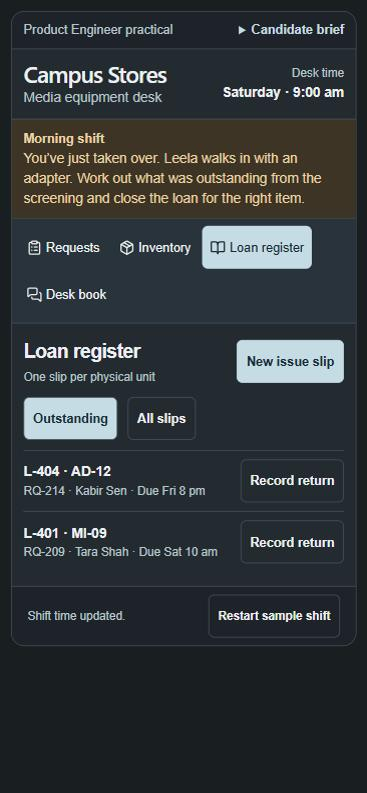
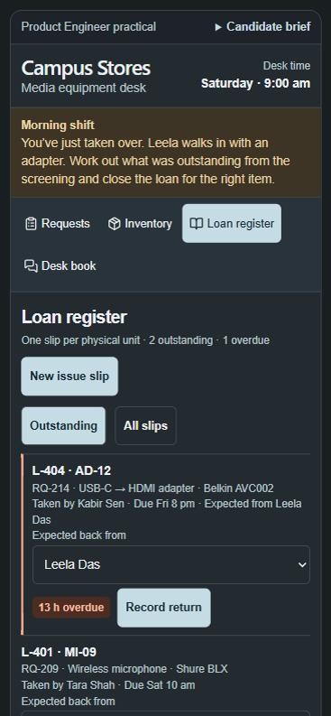

# Campus Stores: work sample

**What I changed:** the Loan register now reads the desk clock.
All of it is in [`app.js`](app.js) (`lateBy`, `since`, `loanRow`, `expectPicker`, and the `data-expect` handler) and [`styles.css`](styles.css) (`.tag.late`, `.row.overdue`, `.expect`).

To see it: open `index.html`, issue the Film Society's three items to Kabir Sen,
advance to **return time**, take back the projector and speaker, then advance to
**next morning** and open the Loan register.

The same moment, before and after. Leela is at the counter holding an adapter:

| Before | After |
| --- | --- |
|  |  |
| Two rows that look alike. One is 13 hours late, the other isn't due for an hour. Leela's name appears nowhere. | The late slip is first, flagged `13 h overdue`, and says it is expected from Leela Das. |

---

## The moment the product handles well

**The issue form only ever offers units that can physically leave the desk.**

Evidence from my shift: at Friday 3:45 pm I opened **New issue slip** to send out the
Film Society's projector. The inventory holds two, PR-04 (BenQ) and PR-06 (Epson),
but PR-06 is in repair, and it never appeared in the dropdown at all. After I issued
PR-04 on slip L-402, it disappeared from the list too. Same for the speaker.

That is the right call. The desk's worst failure is promising someone a thing that
isn't there, and the product makes that promise impossible to make by accident
rather than by catching it afterwards.

The same guard runs on submit, and I tested that too: with RQ-214 selected I tried to
hand Kabir CA-03, a digital camera the Film Society never asked for. The desk refused
in plain language: *"This equipment type is outside the approved request. Choose an
approved unit."* It also refuses a second unit of a type the request has already
taken. I kept all of this untouched.

## The moment I would change

**At Saturday 9:00 am the register could not tell me what was going on.**

Evidence from my shift: Leela Das walked up holding an adapter. I opened the Loan
register and saw exactly this:

```
L-404 · AD-12     RQ-214 · Kabir Sen · Due Fri 8 pm     [Record return]
L-401 · MI-09     RQ-209 · Tara Shah · Due Sat 10 am    [Record return]
```

Three problems, all visible in those two lines:

1. **Leela's name is nowhere.** The person in front of me does not appear on the
   record of the thing she is holding, because Kabir collected it. The only place
   "Leela has the adapter" existed was a free-text note I had typed into the Desk
   book, a different tab, the night before. The app models the connection nowhere,
   so I had to hold it in my head and switch tabs to check.
2. **Nothing was overdue.** L-404 was due Friday 8 pm and it was Saturday morning:
   thirteen hours late. It rendered identically to L-401, which was not due for
   another hour. The desk clock sits in the header, three inches above the register,
   and the register ignored it.
3. **Two adapters are indistinguishable.** AD-12 and AD-15 are both
   "USB-C → HDMI adapter" in bin C4. The row gave me an ID and no way to check it
   against the object in her hand.

The app's own instruction for this phase is *"work out what was outstanding."*
That verb is the problem. Working it out is detective work the record should
have done for me.

## What I built

The register now compares each slip's due time against the desk clock, and lets the
desk record who is bringing a thing back, on the slip, at the moment they find out.

- **Overdue slips are flagged and sorted to the top**: a red `13 h overdue` badge
  and an orange left edge. On-time slips get a quiet green `Due Sat 10 am`.
- **The header counts the work**: `2 outstanding · 1 overdue`.
- **"Expected back from" on every open slip.** One dropdown, on the row itself.
- **Rows show type and model** (`USB-C → HDMI adapter · Belkin AVC002`), so the two
  identical adapter IDs can be told apart against the thing someone is holding.
- **Closing a slip records who brought it**:
  `AD-12 returned to stock from Leela Das. Slip L-404 closed.`

## The same job, with the change

**Friday 7:30 pm.** Kabir returns the projector and speaker and says Leela has the
adapter. I set **Expected back from → Leela Das** on slip L-404. One dropdown, on the
slip, without leaving the register. The row immediately reads
`Taken by Kabir Sen · Due Fri 8 pm · Expected from Leela Das`.

**Saturday 9:00 am.** I open the Loan register. L-404 is the first row, flagged
`13 h overdue`, and reads `USB-C → HDMI adapter · Belkin AVC002 · Expected from
Leela Das`. Leela is standing there holding a Belkin adapter. I press
**Record return**. No tab switch, no note to re-read, no working anything out.

## What I kept

- One slip per physical unit. The partial return only works cleanly because the
  three items were never one record.
- Every validation on the issue form, and the availability filtering above.
- The Desk book. It is the right home for things that aren't about one item
  ("our microphone stays with me overnight"). I moved only the part that was about
  a specific slip.
- No build step, no dependencies, still opens offline straight from `index.html`.
  The change reuses the existing `.row` / `.tag` / `badge()` vocabulary, and
  `.tag.late` follows the same `light-dark()` pattern as `.good`.
- The phone layout. A slip carries more on each line now, so below the existing
  650px breakpoint the row stacks instead of fighting for width. Both screenshots
  above are at phone width.

## The observation that would tell me whether it helped

At a real counter I would watch **how often the desk worker leaves the Loan register
before closing a return.** Today that trip is mandatory: the fact that Leela is
bringing the adapter only exists in the Desk book. If the change worked, returns get
closed from the register alone, and that trip should approach zero.

The counter-signal I would look for: if the **Expected back from** field stays empty
on most slips, the change failed. It would mean the evening shift still finds it
faster to type a sentence into the Desk book than to attach the fact to the slip,
and the right fix would then be to capture the name during the return itself, rather
than asking for it as a separate step.

## What I considered and didn't build

**Contact details for whoever collects the kit.** This was the tempting one, and the
instinct behind it is right: the slip names Kabir because Kabir collected it, when the
fact that matters on Saturday morning is who has it *now*. I dropped it because a phone
number is a recovery tool: it only earns its place once someone has already failed to
turn up. The moment I actually got stuck had Leela standing at the counter. "Expected
back from" fixes the same wrong-name problem structurally, at the point the desk learns
it, and it works whether or not anyone answers their phone. I would revisit contact
details the day the desk tells me its real problem is no-shows rather than
identification, and I would want that in the data first, because storing personal
contact information carries a cost this change does not.

**Searching the register by person.** Useful when someone arrives and you cannot tell
what they are holding. It is a genuinely separate idea, and adding it would have turned
one clear argument into two weaker ones.

**Capturing who returned an item during the return itself.** More robust on paper. But
a return is one click today and this would make it two, on the fast path, at a busy
counter. That is why it sits in this write-up as a hypothesis to test rather than
something I built.

## Trade-offs and limits

- The shift clock is a fixed three-step script, so I modelled due times as minutes on
  a Friday to Saturday timeline (`dueClock`, and a `clock` value per shift). A real
  deployment would compare actual timestamps; the comparison logic would not change.
- **Expected back from** is limited to the five known names. A real desk needs free
  text or a student lookup.
- Saved shifts from before this change still load; the new field is optional and
  the stored schema version is unchanged.

---

## Run the app

Open `index.html` in a modern browser. The app includes its scripts, styles, and icons and can run offline.

To serve it over local HTTP, run this from the repository folder and visit `http://localhost:8000`.

```sh
python3 -m http.server 8000 --bind 127.0.0.1
```

Each browser stores its own sample shift locally when browser storage is available. **Restart sample shift** restores the fictional starting records.

## Source

- `index.html` contains the desk layout, candidate brief, and bundled icons.
- `app.js` contains the sample records and interactions.
- `styles.css` defines the desktop and mobile layouts.

Icon license notices are in [third-party/lucide-LICENSE.txt](third-party/lucide-LICENSE.txt).
